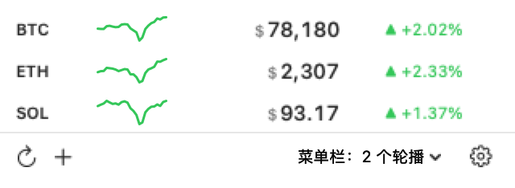

# PriceBar

一个 macOS 菜单栏加密货币价格工具：价格钉在菜单栏，点开是面板（24 小时行情线、涨跌幅），
价格或涨跌幅越过你设的线就发一条系统通知。

需要 macOS 14 以上。没有第三方依赖。

**[产品页 →](https://jovix0101.github.io/pricebar/)** ・ **[下载 .dmg →](https://github.com/jovix0101/pricebar/releases/latest/download/PriceBar.dmg)**



## 装

从[产品页](https://jovix0101.github.io/pricebar/)或 Releases 下 `PriceBar.dmg`，打开后把 `PriceBar.app` 拖进「应用程序」。没有公证，
首次打开若被拦，右键点「打开」一次。

自己编：

```bash
./build.sh                  # build/PriceBar.app 与 build/PriceBar.dmg
open build/PriceBar.app
swift test                  # 49 个测试
```

`./build.sh` 会自动用 Xcode 工具链（`#Preview` 宏需要它）。`NETWORK_TESTS=1 swift test`
会连真实行情跑网络测试。

## 用

- **菜单栏**：`BTC $ 76,584 ▲2.02%`，勾选几个币种就并排显示几个
- **左键图标**：面板；**右键图标**：设置… / 退出
- **面板**：每行一个币种（24 小时线、现价、涨跌），行尾铃铛设提醒，底栏加币、刷新、设置
- **⌘,**：设置；**⌘Q**：退出

设置里可以切计价货币（USD / CNY）、涨跌颜色、刷新间隔、菜单栏显示哪些币种（可拖动排序，
这个顺序也是面板的顺序）、数据源与代理、开机自启。

## 结构

```
Sources/PriceBarCore/       纯逻辑，可测试
  Quote.swift               数据模型与提醒规则
  PriceAPI.swift            行情与汇率，四个交易所的解析
  AppSettings.swift         配置读写、提醒引擎、格式化
  MarketSource.swift        交易所差异：交易对写法、主机、能否批量
  ProxySettings.swift       代理三档与请求会话
  CoinOrder.swift           币种顺序：勾选、拖动、删币之后怎么排
  CoinValidation.swift      添加币种时的校验
  ErrorText.swift           网络错误翻成人话
Sources/PriceBar/           外壳
  main.swift                入口：NSApplication + delegate
  PriceBarApp.swift         AppDelegate：store、主菜单、启动
  StatusItem.swift          菜单栏项、面板 popover、右键菜单
  MenuBarPrice.swift        菜单栏那一行字怎么拼：字号、颜色、补宽
  PanelView.swift           面板与价格行
  AddCoinView.swift         添加币种
  RulesView.swift           提醒规则
  SettingsView.swift        设置窗口
  Sparkline.swift           24 小时行情线
  Store.swift               状态、轮询、写入设置
  Notifier.swift            系统通知与权限
  LoginItem.swift           开机自启
Tests/PriceBarCoreTests/    49 个测试（Swift Testing）
.github/workflows/          GitHub Actions：编译、打包 dmg、发布
docs/                       产品页与截图（GitHub Pages）
build.sh                    编译、写 Info.plist、签名、打 dmg
```

## 几个实现上的取舍

- **不用 `MenuBarExtra`**：它关掉面板后视图不销毁（`onAppear` 只跑一次，行情线永远不刷新）、
  不支持右键、标签是一行纯文本改不了字号。现在是自己的 `NSStatusItem` + `NSPopover`。
- **菜单栏整行是一个 `attributedTitle`**：每段自带颜色，所以「币种和价格听文字颜色设置、
  涨跌幅永远按方向红绿」不需要任何特判。`$` 用 10pt、数字 13pt 等宽，同一基线。
  涨跌幅块按 `▲00.00%` 定宽，用 `.kern` 补——标题会**测量**空格却不**画**它，空格补出来的宽度是假的。
- **不做轮播**：并排显示一次看全，顺序只有一份（设置里拖动的顺序也是面板的顺序）。
- **提醒阈值永远按美元存**，与面板显示哪种货币无关，换货币不会改变规则的意思。
- **行情线只在打开面板时取**，超过 5 分钟才算旧：价格 10 秒一刷，线画得再勤也看不出变化。
- **不做跨交易所兜底**：同一刻四家的 BTC 报价差几十美元，自动换源会让数字莫名跳动。
  只有 Binance 内部的两个域名互为备份。
- **直连是显式关掉代理**（`HTTPEnable: 0`），不是「不设代理」——后者等于去查系统设置。

## 设置文件

`~/Library/Application Support/PriceBar/settings.json`：

```json
{
  "coins": ["BTC", "ETH"],
  "menuBarCoins": ["BTC", "ETH"],
  "currency": "USD",
  "interval": 10,
  "source": "binance",
  "proxyMode": "direct",
  "proxyAddress": "",
  "changeColors": "greenUp",
  "menuBarTint": "automatic",
  "rules": [
    { "coin": "BTC", "metric": "price", "above": true, "threshold": 70000, "armed": true }
  ]
}
```

`metric` 是 `price` 或 `change`（`-5` 表示跌 5%）。`armed` 为 `false` 表示这条规则已经通知过，
价格回到阈值另一侧后会自动变回 `true`。字段读不懂时只退回该字段的默认值，不会丢掉整份配置。

## 发布

`.github/workflows/release.yml` 在 GitHub 自己的 Mac 上编译，下载不需要工具链。

- 推 tag（`git tag v0.2.0 && git push origin v0.2.0`）→ 正式 Release，
  附件是 `PriceBar-<版本>.dmg` 与固定名的 `PriceBar.dmg`
- 推 `main` → 重写 `nightly` 预发布，附件只有固定名的 `PriceBar.dmg`
- 发布版用 `UNIVERSAL=1` 编成通用二进制（arm64 + x86_64）

`PriceBar.dmg` 这个固定名是给产品页的下载按钮用的，链接不能跟着版本号变。

## 已知缺口

- ad-hoc 签名，每次重新构建签名都会变，macOS 可能因此重置通知权限
- 没有公证，首次打开要右键「打开」一次
- 未做 App Sandbox（上架才需要）
