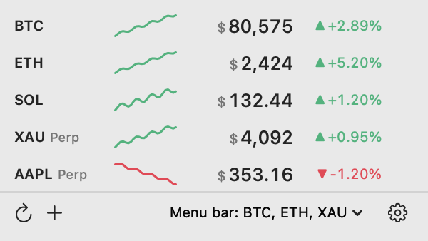

# PriceBar

Prices in your Mac menu bar. Crypto, gold, silver and US stocks sit next to the clock;
click the icon for a 24-hour chart, the day's change, and a notification when a price
crosses a line you set.

**[Website →](https://jovix0101.github.io/PriceBar/)** ・ **[Download .dmg →](https://github.com/jovix0101/PriceBar/releases/latest/download/PriceBar.dmg)** ・ **[中文说明](README.zh-CN.md)**



macOS 14 or later. The download is 2 MB and the installed app takes 2.8 MB. No account, no
subscription, no analytics, no background service.

## What you get

- **Prices in the menu bar** — `BTC $76,584 ▲2.02%`. Tick several instruments and they line up
  side by side, in the order you arrange them.
- **A panel on click** — one row per instrument: 24-hour chart, current price, change. A bell at the
  end of each row sets an alert; the footer adds instruments, refreshes, or opens settings.
- **Price alerts** — one notification when the price or the 24-hour change crosses your threshold.
  Then it waits until the price comes back, instead of nagging every refresh.
- **Crypto, metals and stocks together** — BTC, ETH and the rest at spot price; gold (XAU), silver
  (XAG) and US names such as AAPL, TSLA or NVDA through exchange perpetuals.
- **Four exchanges** — Binance, Gate, OKX and Bybit. Pick one, switch whenever.
- **USD or CNY** — prices convert with a daily exchange rate. Your alert thresholds stay in USD, so
  changing the display currency never changes what a rule means.
- **Light footprint** — a single menu bar app, no third-party dependencies, no separate helper.
- **English and Chinese** — switch in the first settings tab; the change is instant.

## Install

Download `PriceBar.dmg` from the [website](https://jovix0101.github.io/PriceBar/) or
[Releases](https://github.com/jovix0101/PriceBar/releases/latest), open it and drag `PriceBar.app`
into Applications.

The app is not notarized, so macOS may block the first launch. Right-click the app, choose **Open**,
and confirm once. Later launches are normal.

## Using it

- **Left-click the menu bar icon** opens the panel; **right-click** gives Settings and Quit.
- **Adding an instrument**: type the symbol. BTC, ETH and other coins are added at spot price; tick
  the perpetual as well if you want both. Gold, silver and US stocks are perpetuals only.
- **⌘,** opens settings, **⌘Q** quits.
- **Settings, four tabs**:
  - *General* — language, display currency (USD / CNY), up-and-down colours, refresh interval from
    5 seconds to a minute, launch at login.
  - *Menu bar* — which instruments appear and in what order, and the text colour.
  - *Panel* — how many rows before the panel scrolls, and whether clicking a row opens the
    exchange's page for that instrument.
  - *Source and proxy* — which exchange to use, and the proxy: direct, follow the system, or a
    custom address, with a connection test.

## Where the prices come from

Quotes go straight from the app to Binance, Gate, OKX or Bybit over their public WebSocket and REST
endpoints. There is no server in between, nothing is collected, and the only thing written to disk is
your own settings file.

Two things worth knowing about the data:

- **Perpetual prices are not share prices.** They track the underlying but trade 24/7, so they keep
  moving while the stock market is closed and carry a small basis.
- **"24h change" is a rolling 24 hours**, not the change since the previous close, so it will not
  match a stock app.

## Build from source

```bash
git clone https://github.com/jovix0101/PriceBar.git
cd PriceBar

./build.sh            # build/PriceBar.app and build/PriceBar.dmg
open build/PriceBar.app
```

`./build.sh` picks up the Xcode toolchain automatically. `swift test` runs the test suite;
`NETWORK_TESTS=1 swift test` also hits the live exchange endpoints.

## Known limitations

- Not notarized yet, so the first launch needs the right-click → Open step.
- One exchange at a time. Prices are never blended across exchanges: the same BTC can differ by tens
  of dollars between venues, and switching sources automatically would make the number jump for no
  visible reason.
- Binance futures need a proxy on some networks. Binance spot has a separate market-data host that
  usually connects directly; futures only answer on `fapi.binance.com`.

## License

MIT. See [LICENSE](LICENSE).
