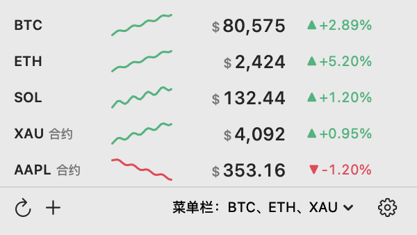

# PriceBar

价格就在 Mac 菜单栏里。币、黄金、白银、美股挨着时钟放着，点开看 24 小时走势和涨跌幅，
价格越过你设的线就发一条通知。

**[产品页 →](https://jovix0101.github.io/PriceBar/zh.html)** ・ **[下载 .dmg →](https://github.com/jovix0101/PriceBar/releases/latest/download/PriceBar.dmg)** ・ **[English](README.md)**



需要 macOS 14 以上。安装包 2 MB，装好占 2.8 MB。不用注册，没有订阅，不做数据统计，也没有后台服务。

## 有些什么

- **菜单栏上的价格** —— `BTC $76,584 ▲2.02%`。勾上几个品种就并排显示几个，顺序按你拖的来。
- **点开是面板** —— 每行一个品种：24 小时行情线、现价、涨跌幅。行尾的铃铛设提醒，底栏添加品种、
  刷新、进设置。
- **价格提醒** —— 价格或 24 小时涨跌幅越过阈值时发一条通知，之后等你把线调回去，而不是每次刷新都催一遍。
- **币、贵金属、股票放在一起** —— BTC、ETH 这些用现货价；黄金 XAU、白银 XAG 和 AAPL、TSLA、NVDA
  这些美股走交易所永续合约。
- **四家交易所** —— 币安、Gate、OKX、Bybit。用哪家选哪家，随时换。
- **USD 或 CNY** —— 按每日汇率换算。提醒阈值始终按美元存，换显示货币不会改变规则的意思。
- **不占资源** —— 一个菜单栏 app，没有第三方依赖，不带额外的后台进程。
- **中英双语** —— 在设置第一页切换，选完立刻生效。

## 安装

从[产品页](https://jovix0101.github.io/PriceBar/zh.html)或
[Releases](https://github.com/jovix0101/PriceBar/releases/latest) 下 `PriceBar.dmg`，打开后把
`PriceBar.app` 拖进「应用程序」。

这个 app 没有公证，首次打开可能被 macOS 拦下。右键点 app，选「打开」，确认一次即可，之后正常双击。

## 怎么用

- **左键菜单栏图标**开面板，**右键**是设置… / 退出。
- **添加品种**：填代号。BTC、ETH 这些默认加现货，需要的话把永续合约一起勾上；黄金、白银、美股只有永续合约。
- **⌘,** 打开设置，**⌘Q** 退出。
- **设置四页**：
  - *通用* —— 界面语言、计价货币（USD / CNY）、涨跌颜色、刷新间隔（5 秒到 1 分钟）、开机自启。
  - *菜单栏* —— 显示哪些品种、什么顺序、文字颜色。
  - *面板* —— 最多显示几行，点击一行是否跳到该品种在交易所的页面。
  - *数据源与代理* —— 用哪家交易所；代理可选直连、跟随系统、自定义地址，带连接测试。

## 价格从哪来

行情由 app 直接连币安、Gate、OKX、Bybit 的公开接口（WebSocket 与 REST），中间没有服务器，
不收集任何东西，落盘的只有你自己的设置文件。

关于数据有两点值得先知道：

- **永续合约的价格不是股价。** 它跟着标的走，但 7×24 交易，美股休市时照样在动，平时也有一点价差。
- **「24h 涨跌」是滚动 24 小时**，不是「比昨收」，所以和股票软件上的数字对不上是正常的。

## 从源码编译

```bash
git clone https://github.com/jovix0101/PriceBar.git
cd PriceBar

./build.sh            # 生成 build/PriceBar.app 与 build/PriceBar.dmg
open build/PriceBar.app
```

`./build.sh` 会自动用 Xcode 工具链。`swift test` 跑测试，`NETWORK_TESTS=1 swift test` 连真实行情跑网络测试。

## 已知限制

- 还没公证，首次打开要右键「打开」一次。
- 一次只用一家交易所。不跨交易所兜底：同一刻四家的 BTC 报价差几十美元，自动换源会让数字莫名跳动。
- 有些网络下币安合约要挂代理。币安现货有单独的行情域名，通常能直连；合约只在 `fapi.binance.com`。

## 许可

MIT，见 [LICENSE](LICENSE)。
